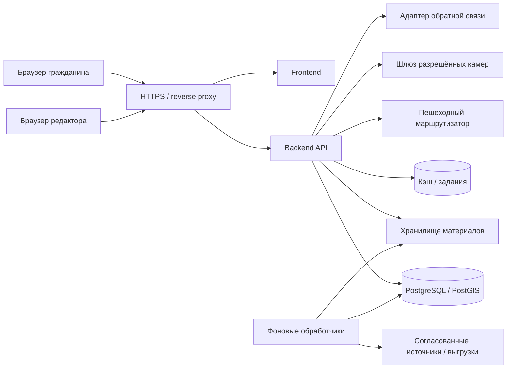

# Архитектура и эксплуатация

Статус: проект технических решений, 12.09.2026. Конкретные версии и инфраструктурные продукты закрепляются после проверки ограничений размещения. Здесь не утверждается, что сервисы уже развёрнуты.

## 1. Предлагаемая структура

Для MVP и начального промышленного контура — модульный монолит с отдельными фоновыми обработчиками. Это позволяет транзакционно публиковать данные и не требует независимой эксплуатации множества микросервисов.

Предлагаемый стек: TypeScript + React для интерфейса; MapLibre GL JS как кандидат для карт; Python + FastAPI для API; PostgreSQL + PostGIS для геоданных; S3-совместимое объектное хранилище; Redis либо аналог для кэша/очереди; Docker-окружение. Маршрутизатор выбирается по качеству пешеходного графа и поддержке изохрон. Это проектный выбор, а не утверждение доступности конкретных API библиотек.

## 2. Модули

| Модуль | Ответственность |
|---|---|
| Реестр | Объекты, организации, справочники, редакции и публикация |
| География | Границы, входы, поиск по bbox, подготовка слоёв |
| Медиа | Метаданные, проверка прав, производные изображения, камеры |
| Аналитика | Версионированные расчёты и публикация агрегатов |
| Закупки | Адаптеры, снимки источников и подтверждение связей |
| Обратная связь | Режим ссылки/виджета или согласованный API |
| Администрирование | Роли, импорт, модерация и аудит |

## 3. Потоки данных

Импорт: получение → неизменяемый исходный пакет с контрольной суммой → staging → проверка → отчёт отличий → подтверждение → новая редакция → публикация → сброс зависимого кэша. Публикация пакета атомарна. Некорректные строки не исчезают: они остаются в отчёте карантина. Частичное принятие возможно только как отдельно подтверждённый пакет валидных строк.

Аналитика: версия границ + версия населения + мощности/оценки + версия методики → расчёт с provenance → проверка → публикация. Расчётная ошибка не заменяет последний опубликованный слой. Старые расчёты сохраняются для воспроизводимости.

Изохрона: ID объекта → опубликованные входы → ключ кэша (входы, 10/15 минут, профиль, версия сети, сценарий) → граф → геометрия → проверка → кэш. Изменение любого компонента ключа исключает выдачу старого результата как нового.

## 4. Интеграционная политика

Для каждого адаптера: владелец, разрешённый способ доступа, авторизация, лимиты, формат, расписание, таймаут, контрольная сумма, правила повторов, журнал, SLA источника при наличии. Секреты поступают через защищённое хранилище окружения.

Для чтения — таймаут 10 секунд, до 3 попыток с увеличением интервала и jitter как стартовые настройки; учитывать Retry-After. Для отправки обращения такие повторы не применяются без поддержки идемпотентности. Использовать outbox и сверку состояния по внешнему идентификатору. Если источник не поддерживает проверку результата, неопределённое состояние передаётся оператору, повторная отправка автоматически запрещена.

Камеры: только allowlist согласованных источников; браузер получает временный адрес шлюза. Проверять URL и каждый redirect, запрещать доступ к локальным/служебным адресам из непроверенного пользовательского ввода. Потоки подрядчиков в частной сети подключаются отдельно администратором. Протокол выдачи браузеру выбирается после обследования, предпочтительно совместимый поток HLS/WebRTC. Ёмкость рассчитывается по количеству зрителей и битрейту отдельно от нагрузки API.

## 5. Защита и приватность

- Публичная API-модель не включает контактные данные, черновики и внутренние комментарии.
- Разделить роли БД, сервисные учётные записи и доступ к хранилищам публичных/закрытых вложений.
- Проверять object-level access, территориальный scope, CSRF для cookie-сессий, XSS и SQL-инъекции. Произвольный HTML описаний не разрешать.
- Вложения проходят карантин и проверку до доступа. Ссылки закрытых файлов короткоживущие. SVG/HTML и исполняемые файлы не принимать в форму жалобы.
- Не записывать в логи токены, текст обращений, контакты и точные координаты заявителя. Контент обращений не передавать внешней аналитике.
- Сроки хранения контактов и обращений определяет согласованный регламент; пока он отсутствует, локальное промышленное хранение запрещено конфигурацией. В базовом режиме перехода эти данные на сервер не поступают.
- Срок хранения технических логов по проекту — 30 дней, аудита изменений — 1 год; значения согласовать с оператором. Удаление должно распространяться на рабочие данные и жизненный цикл резервных копий согласно регламенту.

## 6. Среды и релизы

Среды: local/demo, staging, production. Демо-данные имеют явные метки, отдельные БД/бакеты и не смешиваются с промышленными. Для тестирования использовать синтетические обращения и согласованные обезличенные наборы.

CI: проверка форматирования и ссылок документации → статический анализ → unit/integration → сборка → проверка зависимостей и секретов → end-to-end на staging → публикация версии по принятому процессу. Тесты производительности и восстановления обязательны перед промышленным запуском; их отчёты сохраняются.

Миграции версионируются. До потенциально несовместимой миграции — резервная копия и проверка плана восстановления. Откат приложения возможен только при совместимости схемы; иначе восстановление согласованного снимка с явным учётом RPO. Простое переключение контейнера не гарантирует откат данных.

## 7. Эксплуатационный регламент

| Событие | Обнаружение | Реакция |
|---|---|---|
| API недоступен | 3 неуспешные минутные проверки подряд | Оповещение дежурного, проверка приложения и БД |
| Импорт устарел | Возраст успешного обновления > 48 часов для ежедневного источника | Метка на сайте, уведомление владельца источника |
| Камера не отвечает | Ошибка шлюза или отсутствие нового кадра | Скрыть live-индикатор, показать время последнего кадра |
| Ошибка аналитики | Невалидная геометрия/деление на ноль/неполный пакет | Не публиковать пакет, сохранить предыдущую версию |
| Возможная утечка | Сигнал мониторинга/пользователя | Ограничить доступ, отозвать секреты, сохранить защищённый аудит и действовать по регламенту оператора |

Бэкап: ежедневная защищённая копия БД и версионирование материалов; хранение 30 дней как проектная настройка. Проверять успешность ежедневно. Учение восстановления в изолированной среде включает БД, медиа, конфигурацию, миграции, вход редактора, карточку и расчёт слоя; фиксировать фактические RPO/RTO.

Перед запуском заполнить контакты ответственных, расписания работ, лимиты хранения, сертификаты, процедуры ротации, команды сборки и восстановления. Наличие этого документа без учения не подтверждает готовность эксплуатации.
